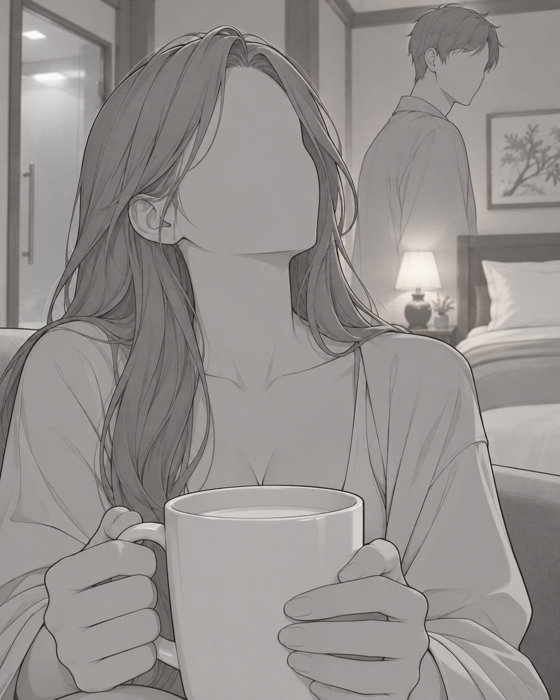
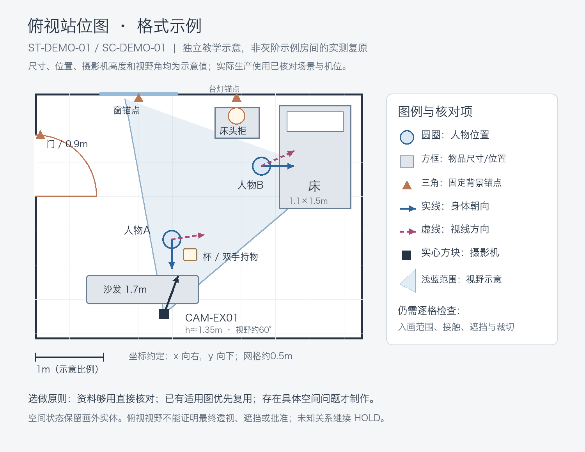

# 画面设计与连续性要求

来源：用户提供的 `B:/PCshare/条漫生产经验.docx`，只提取画面设计、镜头、资产、空间、人物连续性和生图提示词要求；不把排版、气泡、PSD交付要求当作本 Skill 的输出。

2026-10-09 用户确认的画面减法要求优先于旧经验的相邻双项变化规则。具体取景标准见 [shot-framing.md](shot-framing.md)；历史来源不因这次规则更新而被改写。

## 场景资产

- 每个涉及场景应尽量有九宫格：中心为俯视平面图，周围为八个方位的场景视图。
- 建筑轮廓、地形、植被、道具位置、比例尺和场景结构必须在视图间保持一致。
- 透视灭点和地平线要合理；不能因为换视角而移动门窗、墙、路、车辆或大型道具。
- 光源固定在场景坐标中，色温、阴影方向和硬软程度一致；采用自然日光或柔和环境光，避免为不同角度重新设计戏剧性打光。
- 材质和表面细节应清晰可读，不能用情绪光掩盖结构。

## 站位和空间

- D 阶段逐格验证人物、物体、摄影机的位置与朝向，核对遮挡、接触和实际可见范围，在现有站位状态与逐格镜头记录中保存结论；未知空间关系保持 HOLD。
- **站位图与目标机位灰阶构图参考图均为选做，在 D 阶段按需复用或生成。** 两者独立选择，无需成套。现有批准资料能说明关系时直接核对，不补图；已有适用图时复用，不按格数重新制作。普通对话、单人反应、清楚的开阔场景通常无需额外辅助图。
- 人物位置发生移动时，新建站位状态；人物不移动但阻挡、转身、转头或视线关系改变到影响画面时，也应建立新的可见状态。
- 每格从批准机位核对实际入画内容，直接在镜头记录与提示词中写明左右、前后、裁切、可见面、遮挡和接触关系，需要时配套干净目标摄影机视角构图参考；俯视图、文字和箭头留作审阅，构图图片不自动证明空间或执行硬约束。

### D 阶段如何选择辅助图

| 待解决的问题 | 优先选择 | 可以省略的条件 |
|---|---|---|
| 狭小室内、密集家具、门窗通道、多人移动或跨轴，难判断位置与摄影机能否放下 | 俯视站位图 | 现有场景资料和空间记录已能明确说明 |
| 前后景重叠、强遮挡、复杂持物/递接/拥抱、特殊裁切或新机位，难判断最终入画结果 | 目标机位灰阶构图参考图 | 现有批准画面或记录已覆盖本格可见关系 |
| 两类问题同时存在，单一种图不足以核对 | 分别复用或制作所需图 | 一种图加现有证据已经足够时只用一种 |

场景狭小或互动复杂只触发判断，不自动触发制作。先读现有证据，再决定无需、复用或新建；选择理由简短写入已有空间/镜头记录，不新建重复台账。站位图按站位状态复用；构图参考按机位、裁切、画幅及相关可见关系核对后复用。没有选用的图无需占位文件或审阅记录，不因缺图 HOLD；真实空间依据不足继续 HOLD。已登记必须提供的构图参考不能直接改为 NOT_REQUIRED 来放行，应先解决原问题、记录依据，再更新选择。

### 两种图的样式示例

制作相应辅助图前，实际打开下面的图片查看形式。它们只示范信息表达，不是本书批准资产、空间实测、逐格模板或批准证据。

**目标机位灰阶构图参考图**（灰阶分镜构图稿 / 无五官人物占位构图参考图）：

这张用户提供的示例展示：人物在左侧及中央前景，另一人在右侧后景；双手持杯、杯子遮住躯干；门、床和台灯提供背景层级。检查这些位置、比例、朝向、接触、遮挡与裁切。正式制作以本格目标比例和已有空间依据为准，使用灰阶、简化人物和空白五官，保留可判断动作的手部与道具即可，不追求示例的精细发丝、材质或明暗完成度。图中详细发型和衣服仍携带身份信息，不能因为无五官就迁移到正式角色；表情、视线和服装按本格剧本、记录及批准资产执行。干净生图参考不加生产文字、箭头或编号；标注版另留审阅。

可用的生成要求：

> 按本格已核对的目标摄影机、画幅、站位和裁切生成目标机位灰阶构图参考图。使用简化人物占位、空白五官和灰阶轮廓，保留必要动作、手部接触、道具、背景透视与前后遮挡；细节以看清空间关系为限，不加生产标注。不得为构图便利移动固定锚点、增删人物或改变事件。正式人物身份、衣装、表情和视线以后续批准资产与本格记录为准。

调用时用本格真实值替换上述描述并传入实际需要的参考，不把这段说明或本示例当成所有格子的固定提示词。生成后从原场景证据与目标机位复核；失配继续候选/返修，生成结果不能反过来证明未知空间。

**俯视站位图**：

此图是独立的教学示意，位置、尺寸和视野角度均为示意值，**不是对上图房间的实测复原**。需要制作时按实际场景比例绘制：圆圈与文字标记人物，方框标记物品及尺寸，门窗等用锚点标记；实线箭头表示身体朝向，虚线箭头表示视线；标出摄影机位置、高度、朝向与视野范围，并给出状态 ID、场景 ID、比例/坐标约定和图例。保留画外人物与固定物体；逐格入画范围另在镜头记录中说明。它用于空间审阅，不作为最终摄影机视角图片。

## 镜头和真实可见画面

- 同场景连续格按当前适用镜头规则、焦点、视线和必显信息设计变化，命中 MEM-010 时使用其判据；不得拉远破坏裁切、穿墙或移物。真实格对例外须准确绑定，不套用旧宽松说明。
- 机位可以正、侧、斜、背、俯、仰、近、远、局部、遮挡或画外，但不应把全话简化为机械正反打。
- 人物不必面对观众；身体和脸的朝向以空间记录和相机位置推导，需要时借助站位图核对。
- 必须从相机实际位置模拟画面中能看见什么、看不见什么、人物背后是什么、物品在哪个画面位置、前后遮挡如何发生。
- 反打必须服从物理空间。左侧机位看到微侧正脸，跨过空间反打后，可能只应看到大部分后脑勺和少量面部，不能仍然给出完整侧脸。
- 不为展示完整人物肢体或道具而破坏遮挡关系。被桌子、门框、前景人物挡住的部分应保持被挡住。
- 明确腰以上/胸以上/肩以上或局部裁切；全身和全景分别论证。摄影机外的人物与固定物体仍保留在空间记录中，不因本格不画而被删除。

## 人物连续性

- 每格逐人检查微表情、动作、视线和身体状态。
- 同角色相邻脸部可比较时执行当前 MEM-007；源稿动作、身体状态和批准可见范围仍独立核对，不能为表情变化改剧情。
- 不得让人物在多个连续格中脸部朝向完全一致；改变机位时要重新推导实际看到的脸部角度。
- 发饰、伤势、衣服标志、道具和脸部标志固定在角色自身的同一侧。
- 角色面对观众时，将角色自身左/右翻译为画面中的实际位置。例如角色自身左额的伤势，在角色面向观众时应描述为画面右侧额头。

## B提示词语言

- 用现实镜头拍摄逻辑描述最终画面，不向生图工具讲解空间推导原理。
- 方位使用画面整体坐标：画面左、画面中央、画面右、画面上部、画面下部、前景、中景、后景。
- 说明面对观众、背对观众、露出大部分后脑勺和少量面部等实际可见结果。
- 提示词短、具体、可执行；背景结构要足够具体，不能只写“室内”“街道”“参考图”。
- 每格只引用真实存在且实际复制到本格目录的参考图。
- 正文只描述实际入画的人物、身体区域、必要物件和背景锚点；参考中的全身或整个房间不授权扩大本格取景。

当前新RV的可执行记录以 [具体视觉证据](visual-evidence.md) 为准：固定布局→人物状态→镜头可见范围，分别编译与审查。旧H001/H002术语只用于原冻结RV。

设计上下文、生成输入依赖与最终实图比较分别记录。只有调用必须携带前格图才写generation_dependencies；比较待补不阻塞无真实输入依赖的独立生成。本地观察可先保存，完整QA和最终D不得跳过真实连续性核对。本话仅等跨话时交总控后结束本轮。
